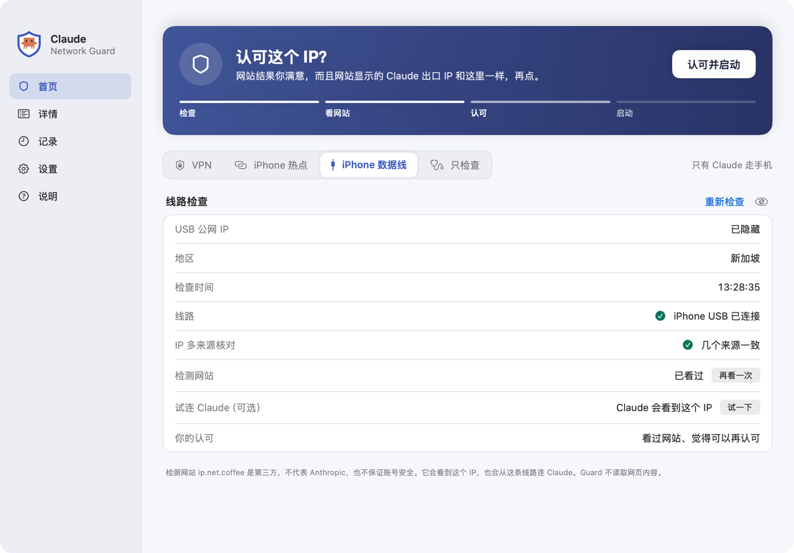
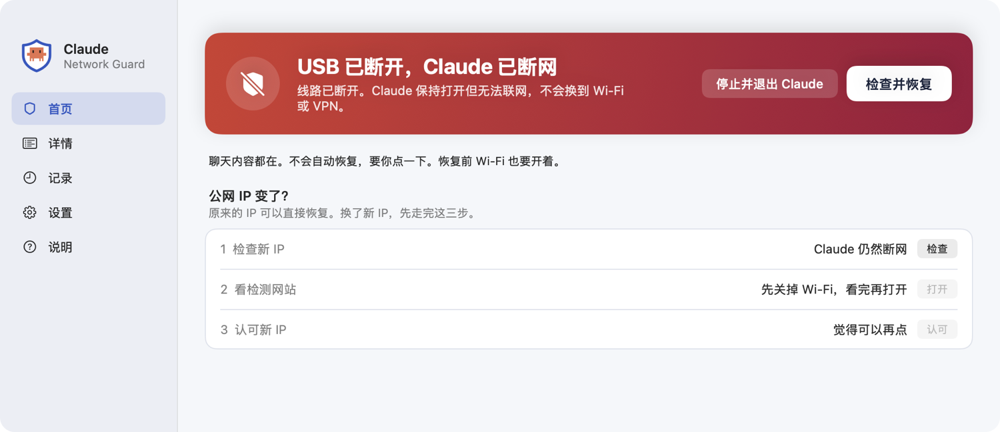
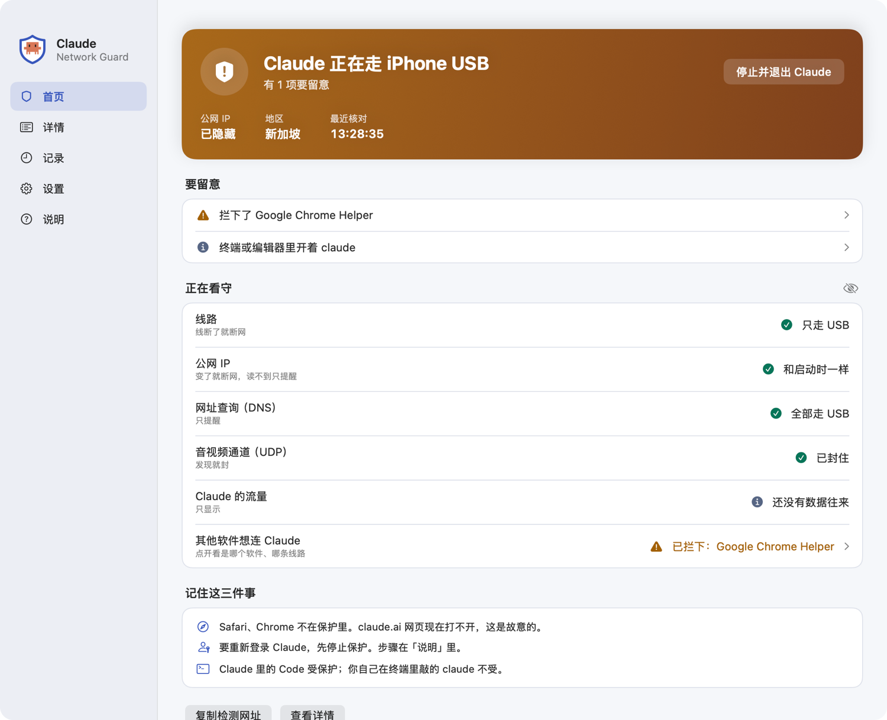
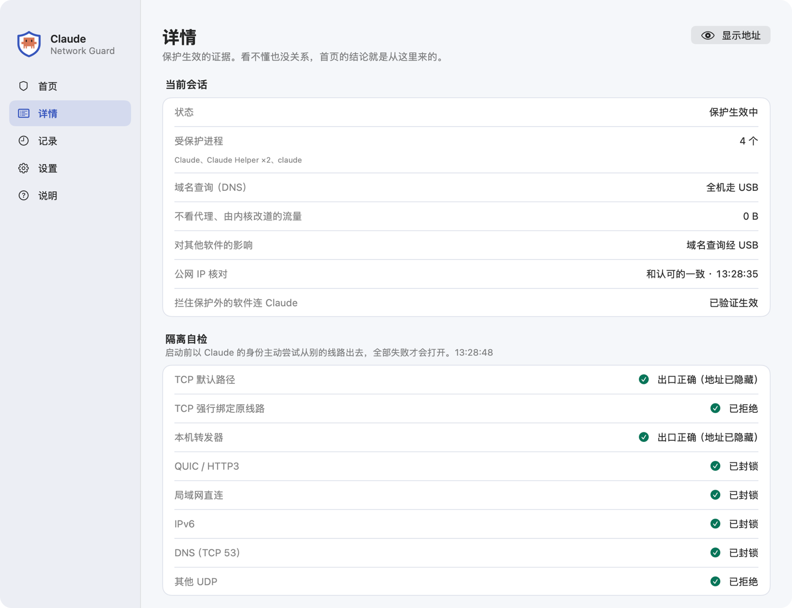
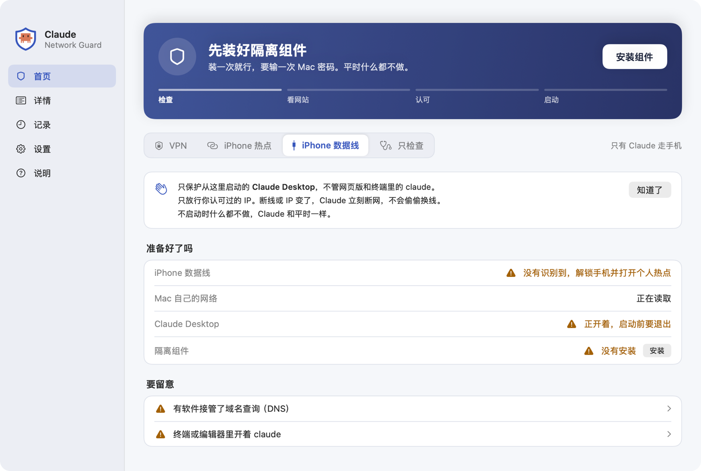

<div align="center">


# Claude Network Guard

**Keep Claude Desktop on the one network you have personally approved.**
If the link drops or the IP changes, Claude goes offline instead of silently switching.

   

[简体中文](README.md) · **English**

[Install](#install-once) · [Permissions](#permissions) · [Daily use](#daily-use) · [Limits](#know-the-limits-first) · [Troubleshooting](#troubleshooting)

<picture>
  <source media="(prefers-color-scheme: dark)" srcset="docs/images/running-dark.png">
  
</picture>

<sub>Screenshots use sample data. The app's interface is in Chinese only.</sub>

</div>

> Unofficial and not affiliated with Anthropic. The Claude name and character belong to Anthropic.

---

## Why

When a Mac has Wi‑Fi, a VPN and a phone connected, macOS moves to another link as soon as one drops. Claude moves with it, and you are not told.

Guard pins Claude Desktop to a single link. **Only an IP you have looked at and approved is allowed; everything else is blocked.** Other apps keep using the network as usual.

When protection is off, it does nothing.

## What it does today

| Link you choose | What uses it | If it drops or the IP changes |
|---|---|---|
| **iPhone USB cable** | Claude only. Other apps stay on Wi‑Fi or VPN | Claude goes offline but stays open |
| **System-wide VPN** | The whole Mac | Claude goes offline but stays open |
| **iPhone hotspot** | The whole Mac | Claude goes offline but stays open |
| **Check only** | No protection, just inspects the current network | — |

- **Check, approve, launch.** Claude is not launched on an IP you have not approved.
- **Kernel-level cut-off.** Rules live in the macOS firewall and keep working if the Guard window crashes.
- **Covers child processes.** Code, the terminal panel, commands, MCP servers and the built-in browser.
- **Keeps checking the public IP.** Every 5 seconds; a change cuts Claude off.
- **Blocks other apps from reaching Claude over other links,** such as a Claude browser extension, and tells you which app it was.
- **Closes common leaks.** UDP, QUIC, IPv6, the local network, and DNS over TCP port 53.
- **Self-test before every launch.** It tries to get out over other links and opens Claude only if every attempt fails.
- **Cleans up.** Stopping removes the rules, proxy settings and DNS entries.

| Approve this IP | Link dropped |
|:---:|:---:|
|  |  |
| **Needs attention** | **Self-test details** |
|  |  |

It does **not** provide a network, proxy or account. It does not change fingerprints, time zone or language, and it does not score IPs.

---

## Requirements

- Apple silicon Mac (M1 or later), macOS 13 or later. **Only tested on macOS 27 so far**
- The official Claude Desktop in `/Applications`
- One of: iPhone with a cable, a system-wide VPN, or an iPhone hotspot
- The Mac's administrator password

Xcode and an Apple developer account are not needed.

## Install (once)

**1. Quit Claude Desktop** (⌘Q; closing the window is not enough).

**2. Open the system Terminal and paste:**

```bash
git clone https://github.com/james123wang5/claude-network-guard.git ~/ClaudeNetworkGuard
```

> The first time, macOS offers to install the command line developer tools. Click Install, wait, then paste again.

**3. Then paste:**

```bash
cd ~/ClaudeNetworkGuard && ./install.sh
```

> It compiles on your Mac, which takes a while. Enter your Mac login password when asked; **nothing is shown while you type.**

**4.** Guard opens by itself. Later, open **Claude Network Guard** from Applications.

Please install this way. A zip downloaded from the web page may be blocked by macOS.

**To update,** stop protection, quit Guard and Claude, then run:

```bash
cd ~/ClaudeNetworkGuard && git pull && ./install.sh
```

## Permissions

| What | Where | Why | Required |
|---|---|---|---|
| Command line developer tools | Prompt during install: Install | Compiles on your own Mac | ✅ |
| Administrator password | When installing or updating the component | Firewall rules need administrator rights | ✅ |
| Background item | System Settings › General › Login Items & Extensions. If macOS says a background item was added, leave it on | It does the cut-off and blocking | ✅ |
| Notifications | Guard: 设置 (Settings) › 异常通知 › 启用, then Allow | Tells you when Claude goes offline | Recommended |
| Trust This Computer | Prompt on the iPhone when plugged in | Internet over the cable | ✅ for cable |
| Personal Hotspot | iPhone Settings › Personal Hotspot › Allow Others to Join | Cable or hotspot internet | ✅ for iPhone |

**Not needed:** Full Disk Access, Accessibility, Screen Recording, Contacts, Location or system extensions. Guard does not ask for them.

## Close these first

| Close | Why |
|---|---|
| Claude Desktop (⌘Q) | Only protected when opened from Guard |
| claude.ai tabs and Claude browser extensions | They get blocked and keep raising reminders |
| `claude` in terminals and editors | Not protected |
| The "system proxy" switch in proxy apps | The route cannot be confirmed. **A system-wide VPN can stay on** |
| Work or school security software with a DNS proxy | May take over DNS lookups. See System Settings › Network › Filters & Proxies |

Guard detects most of these and reminds you on the home screen:

<div align="center"></div>

## Daily use

Keep clicking the button on the home card.

1. **Choose a link and click 检查线路 (Check link).** This does not contact Claude.
2. **Click 打开检测网站 (Open check site),** review the IP, then click 看完了 (Done). With the cable, a blank browser window opens over the phone, so Wi‑Fi can stay on.
3. **If you are satisfied, click 认可并启动 (Approve and launch).** The IP is checked once more before Claude opens.
4. **When finished, click 停止并退出 Claude (Stop and quit Claude).** Opening Claude from the Dock is then back to normal.

An approval lasts 24 hours and is void as soon as the IP changes.

| Card color | Meaning |
|---|---|
| 🔵 Blue | Not started |
| 🟢 Green | Protected |
| 🟡 Yellow | Protected, something needs attention |
| 🔴 Red | Offline, waiting for you |

---

## Know the limits first

### What is covered

| | |
|---|---|
| ✅ | Claude Desktop launched from Guard: chat, Code, built-in browser, terminal panel and the commands they run |
| ❌ | claude.ai in a browser, Claude on a phone |
| ❌ | Claude browser extensions (Claude in Chrome) |
| ❌ | Claude opened from the Dock |
| ❌ | `claude` you run yourself in Terminal or VS Code ([one exception, in Chinese](BOUNDARIES.md#终端里的-claude)) |
| ❌ | Apps Claude opens or controls, such as Safari, Xcode or a simulator; they use their own network |

### What it cannot prevent

- **The few to a dozen or so seconds after a silent IP change.** If the link stays up, the change is only caught at the next check.
- **IPs written in content.** If a screenshot, page or file contains your IP, Claude can read it.
- **Requests by macOS itself,** such as push notifications and certificate checks.
- **Work done on Anthropic's servers,** such as web search, which never goes through your Mac.
- **Local proxy ports not set as the system proxy.** A command hard-coded to use one will go out through it.
- **Account safety.** It does not make an account "safer" and cannot say how Anthropic views an IP. Follow Anthropic's terms and local rules.

### Unavailable while protected

- Signing in to Claude in an external browser (stop protection first)
- `sudo` inside Claude
- The local network and work or school intranets (single addresses can be allowed in Settings)
- UDP, QUIC and IPv6 (apps fall back; usually unnoticeable)

### Not tested yet

Sleep/wake and restart, a real public IP change, another Mac or macOS version, other VPNs, native IPv6 networks, and Cowork in a local virtual machine.

Full details (Chinese): **[BOUNDARIES.md](BOUNDARIES.md)**

## Who it contacts

No analytics and no server of its own. When checking IPs it contacts the public services below. They see the IP of the chosen link, and for some checks the IP of the Mac's default link:

- Cloudflare, AWS `checkip`, ipify, icanhazip: to read the public IP
- `ip.net.coffee`: a third-party check site, opened only when you click
- `claude.ai`, `api.anthropic.com`: only when you click 试连 Claude (Test Claude)

---

## Troubleshooting

| Situation | What to do |
|---|---|
| **Red, offline** | Claude is still open and chats are intact. Restore the link and click 检查并恢复 (Check and resume). It never resumes by itself |
| **IP changed** | If the old IP returns, you can resume. A new IP must be checked, reviewed and approved |
| **Need to sign in again** | Stop protection first. With the cable, turn Wi‑Fi off while signing in, then on again |
| **An app was blocked** | Usually a Claude browser extension or a claude.ai tab. Remove or close it |
| **Claude closed after updating itself** | It reopened outside protection and Guard closed it. Launch from Guard again |
| **iPhone USB not found** | Unlock, trust, turn on Personal Hotspot, replug if needed |
| **"Both links have the same exit"** | The Mac's Wi‑Fi is this same phone. Use another Wi‑Fi |
| **Need a work or school server** | Add `IP:port` under 设置 › 允许的内网地址 (Settings › Allowed intranet addresses) |
| **Guard crashed** | Protection continues in the background component and the kernel |

## Uninstall

Stop protection, quit Guard and Claude, then run:

```bash
cd ~/ClaudeNetworkGuard && ./uninstall.sh
```

## Documentation (Chinese)

[Limits and tests](BOUNDARIES.md) · [How it works](ARCHITECTURE_USB.md) · [Test log](VERIFICATION.md) · [Verify it yourself](ACCEPTANCE.md)
