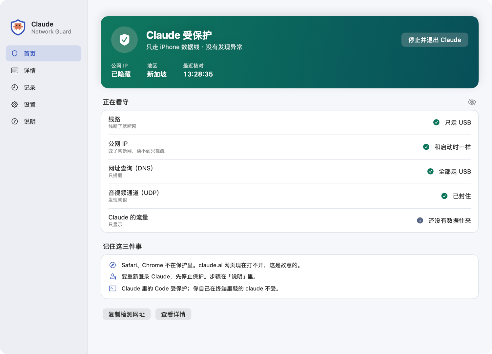

<div align="center">


# Claude Network Guard

**On the road, keep Claude on the one network you approved.**

Phone roaming, USB cable, hotspot or VPN: pick one, look at its IP yourself, approve it.
If the line drops or the IP changes, Claude goes offline at once. It never quietly switches networks.

    

[简体中文](README.md) · **English**

[Why](#why) · [Three ways to use it](#three-ways-to-use-it) · [Quick start](#quick-start) · [⚠️ Boundaries](#️-boundaries-read-before-use) · [FAQ](#faq)

<picture>
  <source media="(prefers-color-scheme: dark)" srcset="docs/images/running-dark.png">
  
</picture>

<sub>Screenshots use sample data</sub>

</div>

> [!IMPORTANT]
> **A personal open-source project, unofficial and not affiliated with Anthropic.** It only controls which network Claude uses. **It does not protect your account and takes no responsibility for account restrictions, data charges or any other loss.** Read the [boundaries](#️-boundaries-read-before-use) first.

---

## Why

People studying or working in Singapore (NTU, NUS students and others) often travel with **their local SIM on international roaming and let the laptop use the phone's data**, instead of joining unknown airport or hotel Wi‑Fi.

The trouble is that a Mac won't stick to the network you meant:

- If the cable comes loose or the hotspot drops, the Mac **falls back** to hotel Wi‑Fi, and Claude goes with it without telling you;
- If a VPN or proxy app restarts or crashes, traffic **goes out directly** on the local network;
- You want Claude on roaming, but not system updates, cloud drives and videos eating your roaming data.

**Claude Network Guard locks only Claude to the network you approved.** Everything else works as usual.

## Design

1. **Only Claude, nothing else.** Only Claude Desktop opened from Guard (including Code, the built-in browser, the terminal and the commands they run) is locked. Browsers and chat apps are untouched.
2. **You judge the IP.** Guard doesn't score IPs; it takes you to a test site to look for yourself, and lets Claude through only after you click "Approve".
3. **Fail closed.** The rules live in macOS's built-in firewall (in the kernel). Line down, IP changed, rules flushed by another app: Claude goes offline instead of finding another way out. It keeps working even if the Guard window crashes.

## Three ways to use it

| | ① Roaming + USB cable (recommended) | ② Roaming + hotspot | ③ System-wide VPN |
|---|---|---|---|
| Setup | iPhone with roaming and Personal Hotspot on, cabled to the Mac | iPhone with roaming and Personal Hotspot on, Mac joins its Wi‑Fi | Full-tunnel (TUN) VPN on the Mac |
| What uses this line | **Only Claude** | The whole Mac | The whole Mac |
| Other apps | Keep using local Wi‑Fi or VPN, **no roaming data used** | Also on roaming | Also on the VPN |
| Claude's IP | The phone's roaming exit | The phone's roaming exit | The VPN node |
| What Guard does | Locks Claude + checks the IP every 5 s | Locks the line + checks the IP | Locks the line + checks the IP, blocks apps that bypass the VPN to reach Claude |
| When it drops | Claude goes offline immediately, stays open, waits for you | Same | Same |

> ③ isn't roaming; it's for home or campus with your own VPN.

**About the roaming exit:** with a local SIM on roaming, traffic is usually routed back through your home carrier, so the IP usually shows your home country. **Some travel eSIMs and plans break out locally instead**, giving a local IP. Guard takes you to a test site: **check before approving**.

## Supported devices

| | Supported | Notes |
|---|---|---|
| Computer | **Mac only**: Apple silicon (M1 or later) | **Tested on macOS 27.** Other versions should work (the code targets macOS 13 and later) but are untested; if it fails to install or misbehaves, please open an issue. No Intel Mac, Windows or Linux |
| Phone | **iPhone** with Personal Hotspot | Android is **not supported** |
| Claude | Official Claude Desktop in Applications | Only the Anthropic-signed app |

No Xcode, no Apple developer account, no server.

---

## Quick start

### Option 1: let your AI assistant do it

Send this to the coding assistant you use (Codex, Cursor, etc.). **Type the password yourself** when asked:

```text
Install https://github.com/z3Ra1n/claude-network-guard on this Mac:
make sure Claude Desktop is fully quit, git clone it to ~/ClaudeNetworkGuard,
then run ./install.sh. Stop and let me type the admin password myself. Tell me the result.
```

### Option 2: install it yourself (4 steps)

**1. Quit Claude completely:** press ⌘Q in Claude. Closing the window is not enough.

**2. Open Terminal** (⌘ Space, search "Terminal"), paste this line and press Return:

```bash
git clone https://github.com/z3Ra1n/claude-network-guard.git ~/ClaudeNetworkGuard
```

> If macOS offers to install the command line developer tools, click "Install", then paste the line again.

**3. Paste this line and press Return:**

```bash
cd ~/ClaudeNetworkGuard && ./install.sh
```

> It builds on your Mac and takes a few minutes. When asked for a password, type your Mac login password. **Nothing appears while you type; that's normal.** Then press Return.

**4. Guard opens when done.** Later, find **Claude Network Guard** in Applications.

**Then allow two things:**

| What pops up / where | What to do |
|---|---|
| "Background item added" (or System Settings › General › Login Items & Extensions) | Keep Guard **on**; cutting off and blocking depend on it |
| Guard › Settings › Alerts | Enable, then "Allow", to get a notice when Claude is cut off |

On the iPhone: tap "**Trust** this computer" after plugging in; turn on Settings › Personal Hotspot › "**Allow Others to Join**"; make sure **roaming is on** before you travel.

> Guard does **not** need Full Disk Access, Accessibility, Screen Recording or Location. If something asks for them in its name, say no.

### Everyday use

**Just keep clicking the button on the home card.**

1. **Pick a line, click "Check line".** This does not contact Claude.
2. **Click "Open test site",** see where the IP is, what type it is and its reputation, then click "Done".
3. **If you're happy, click "Approve and start".** The IP is checked once more; Claude opens only if it matches.
4. **When done, click "Stop and quit Claude".**

| Card colour | Meaning |
|---|---|
| 🔵 Blue | Not protecting |
| 🟢 Green | Protecting, all good |
| 🟡 Yellow | Protecting, something to look at |
| 🔴 Red | Cut off, waiting for you |

| Approve this IP | Line dropped |
|:---:|:---:|
|  |  |

---

## ⚠️ Boundaries (read before use)

### 1. It doesn't change whether you may use Claude

Where and how Claude can be used is set by **Anthropic's supported regions and terms of service**. Guard only controls which network Claude's traffic takes. **It does not make any use compliant and makes no promise about how Anthropic treats an IP or account.** Check and follow Anthropic's terms and your local laws yourself.

### 2. It covers one thing

| | |
|---|---|
| ✅ Covered | Claude Desktop **opened from Guard**: chat, Code, built-in browser, terminal panel, and the commands they run |
| ❌ Not covered | **The Claude phone app**, claude.ai in a browser, browser Claude extensions; they use whatever network they're on |
| ❌ Not covered | Claude opened from the Dock or Spotlight (Guard closes it during protection) |
| ❌ Not covered | `claude` you run yourself in Terminal or VS Code |
| ❌ Not covered | Other apps Claude opens for you (Safari, Xcode, Simulator…); they use their own network |

**To use only your approved IP, don't use Claude on your phone or the web during protection.** Also turn off "open at login" for Claude so it can't go online before you start protection.

### 3. What it can't prevent

- **The few to dozen seconds when the line stays up but the IP silently changes.** Guard checks every 5 seconds.
- **IPs written in content.** If a screenshot, page or file shows your IP, Claude can read it. Guard hides IPs by default; don't let Claude open IP-check pages or account sign-in history.
- **macOS's own traffic**, such as push notifications and certificate checks.
- **Local proxy ports not set as the system proxy.** A command hard-wired to that port goes out through the proxy.

### 4. Not tested yet

- **Real cross-border roaming** (USB, hotspot and VPN modes are all tested, but not while roaming abroad)
- Sleep/wake, restart, hours of continuous use
- Cut-off on a real public-IP change (only simulated)
- Other Macs and macOS versions, other VPN and proxy apps, native IPv6 networks

What has been tested: [VERIFICATION.md](VERIFICATION.md). Every detailed boundary: [BOUNDARIES.md](BOUNDARIES.md) (Chinese).

### 5. Disclaimer

Provided "as is". The author is not responsible for account restrictions or bans, data charges, data loss or any other consequence. All code is public; feel free to review it.

---

## FAQ

**My browser uses a VPN while Claude is protected over the iPhone cable. Do they interfere?**
No (tested). The browser keeps using the VPN; Claude uses only the phone.

**If my VPN or proxy app restarts, crashes or falls back to "direct", can my local IP leak to Claude?**
By the rules and tests, no: when the VPN drops, Claude is cut off within a second; if the proxy goes direct, or another app tries to bypass the VPN to reach Claude, it's blocked and the home screen says "Blocked xxx". The one gap is the exit silently changing while the line stays up (e.g. the proxy switches nodes), so **pin Claude to one fixed node**, not an auto-select, fallback or load-balance group.

**Will other apps eat my roaming data?**
Not in ① USB mode: only Claude uses the phone. In ② hotspot mode, the whole Mac does.

**Are Claude cloud projects protected?**
The cloud part runs on Anthropic's servers with their IPs. Viewing and controlling them in the Claude opened by Guard is protected; checking from the phone app or the web is not.

**It turned red?**
Claude is still open and your chats are there. Reconnect and click "Check and restore". It never restores by itself.

**The IP changed?**
Back to the original IP: restore directly. A new IP: check, view the site, approve again.

**I need to sign in to Claude again?**
Sign-in opens an external browser, which is blocked during protection. Stop protection first; with the cable, turn Wi‑Fi off while signing in so the whole Mac uses the phone; then turn Wi‑Fi on and start again from Guard.

**It says it blocked some app?**
An app outside protection tried to reach Claude over another network and was stopped. Usually a browser Claude extension or a claude.ai tab; close it.

**iPhone not detected?**
Unlock it, tap "Trust", turn on Personal Hotspot; replug if needed.

**"Both lines have the same exit"?**
Your Mac's Wi‑Fi is this phone's hotspot. Use another Wi‑Fi, or choose "iPhone hotspot".

**Need a campus or company server?**
Claude can't reach private networks during protection by default. Add `IP:port` under Settings › Allowed private addresses to allow just that one.

**Guard crashed?**
Protection continues; the background component and the system firewall do the work.

<details>
<summary>Best to turn off before starting (Guard warns about most)</summary>

| Turn off | Why |
|---|---|
| Claude Desktop (⌘Q) | It must be opened from Guard to be protected |
| claude.ai tabs and Claude extensions in browsers | Otherwise they get blocked and keep warning |
| "System proxy" switch in proxy apps | Guard can't confirm which network that traffic uses. **A system-wide (TUN) VPN is fine** |
| Company/school security software with a "DNS proxy" | It may take over name lookups. See System Settings › Network › Filters & Proxies |

</details>

<details>
<summary>Not available during protection</summary>

- Signing in to Claude in an external browser (stop protection first)
- `sudo` inside Claude
- Local, campus and company networks (can be allowed one by one)
- UDP, QUIC, IPv6 (fall back automatically, usually unnoticeable)

</details>

<details>
<summary>What Guard contacts</summary>

No analytics, no server of its own. To check the IP it uses these public services, which see the selected network's IP:

- Cloudflare, AWS `checkip`, ipify, icanhazip: read the public IP
- `ip.net.coffee`: third-party test site, only when you click
- `claude.ai`, `api.anthropic.com`: only when you click "Test Claude connection"

</details>

---

## Update and uninstall

Stop protection, quit Guard and Claude, then paste into Terminal:

```bash
cd ~/ClaudeNetworkGuard && git pull && ./install.sh
```

```bash
cd ~/ClaudeNetworkGuard && ./uninstall.sh
```

## Docs

| To learn | See |
|---|---|
| Every boundary | [BOUNDARIES.md](BOUNDARIES.md) |
| How it works | [ARCHITECTURE_USB.md](ARCHITECTURE_USB.md) |
| What each version tested | [VERIFICATION.md](VERIFICATION.md) |
| Verify it yourself | [ACCEPTANCE.md](ACCEPTANCE.md) |

## Open source and license

**[MIT License](LICENSE)**: all code is public; anyone may use, modify and redistribute it for free.

Found a problem? Open an [issue](https://github.com/z3Ra1n/claude-network-guard/issues). Want to improve it? PRs welcome.

**If it helps you, a ⭐ Star means a lot.**

<sub>Claude is a trademark of Anthropic. This is an independent community project with no affiliation with or endorsement by Anthropic.</sub>
