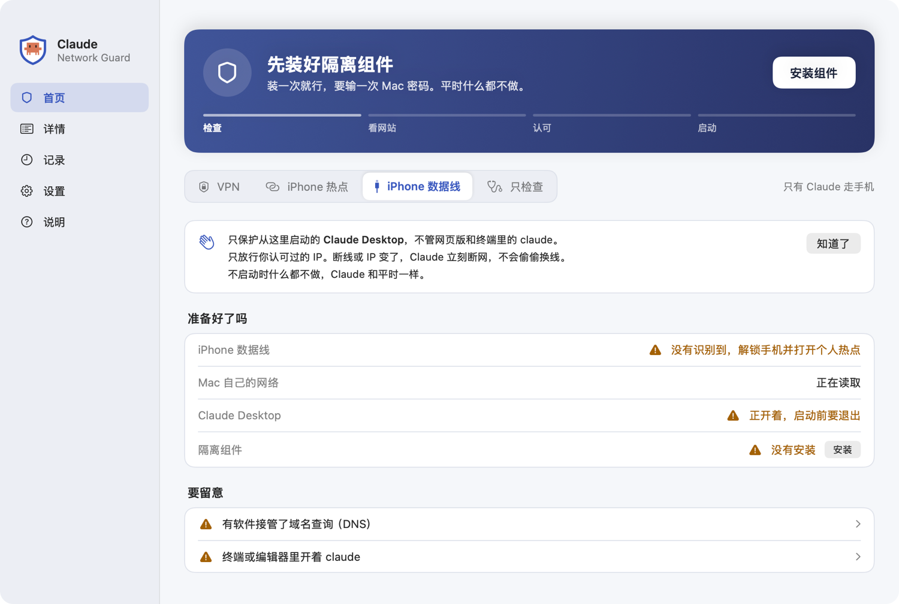

<div align="center">


# Claude Network Guard

**让 Mac 上的 Claude 只走你认可过的那条网络。**
线断了、IP 变了，Claude 马上断网，绝不偷偷换到别的网络。

  

**简体中文** · [English](README.en.md)

[它是干什么的](#它是干什么的) · [先记住这几条](#先记住这几条) · [安装](#安装只要一次) · [每次怎么用](#每次怎么用) · [常见问题](#常见问题)

<picture>
  <source media="(prefers-color-scheme: dark)" srcset="docs/images/running-dark.png">
  
</picture>

<sub>截图均为示例数据</sub>

</div>

> 非官方软件，与 Anthropic 无关。Claude 的名字和形象属于 Anthropic。

---

## 它是干什么的

举个例子：你在机场，Mac 连着机场 Wi‑Fi，又插着手机用流量。你只想让 Claude 走手机。

麻烦在于：手机线一松，或者 VPN、代理软件一重启，Mac 会**自动换到另一条网络**，Claude 也跟着换过去，你根本不知道。等你发现，Claude 已经用别的 IP 联网了。

Guard 就是来管这件事的：

1. 你先选一条网络，**亲眼看一下它的 IP**，满意了点「认可」。
2. Guard 从这条网络打开 Claude，**把 Claude 锁死在上面**。
3. 网络断了或 IP 变了，**Claude 立刻断网**（但不会关掉，聊天都在），等你处理。
4. 其他软件（浏览器、微信……）不受影响，照常上网。

平时不点启动，它什么也不做。

它**不提供** VPN、代理或账号，也不改设备指纹、时区、语言。

## 先记住这几条

> **1. Claude 一定要从 Guard 里打开。** 从程序坞、Spotlight 打开的 Claude 不受保护（保护中 Guard 会把它关掉）。
>
> **2. Guard 只管 Mac 上的 Claude Desktop。** 手机上的 Claude App、浏览器里的 claude.ai 都**不管**，它们走自己当时的网络。想全程只用认可过的 IP，保护期间就别用手机和网页登录 Claude。
>
> **3. 用手机数据线或热点时，Claude 用的是手机流量的 IP。** 手机上开着 VPN（如 Shadowrocket）通常**也不会**改变这个 IP。认可前看清楚检测网站显示的是什么。
>
> **4. 变红了不要慌。** 这表示已经安全断网。接好网络，点「检查并恢复」。
>
> **5. 用完点「停止并退出 Claude」。**
>
> **建议**：把 Claude 的“开机自动打开”关掉（Claude 的设置，或「系统设置 › 通用 › 登录项」），免得它在你启动保护之前就自己联网了。

---

## 需要什么

- 苹果芯片的 Mac（M1 及以后），macOS 13 或更新。**目前只在 macOS 27 上实测过**
- 「应用程序」里装好官方的 Claude Desktop
- 下面三样之一：**iPhone + 数据线**、**整机 VPN**、**iPhone 热点**
- Mac 的开机密码

不需要 Xcode，也不需要苹果开发者账号。

## 安装（只要一次）

**1. 完全退出 Claude**：在 Claude 里按 ⌘Q。只关窗口不算。

**2. 打开「终端」**（按 ⌘ 空格，搜“终端”），复制下面这行，粘贴进去，按回车：

```bash
git clone https://github.com/z3Ra1n/claude-network-guard.git ~/ClaudeNetworkGuard
```

> 如果弹出“安装命令行开发者工具”，点「安装」，装好后再粘贴一次上面那行。

**3. 再粘贴这一行，按回车：**

```bash
cd ~/ClaudeNetworkGuard && ./install.sh
```

> 这一步会在你的 Mac 上现场编译，要等几分钟。
> 让你输密码时，输 Mac 的开机密码，然后按回车。**输的时候屏幕上什么都不显示，这是正常的。**

**4. 装好后 Guard 会自动打开。** 以后在「应用程序」里找 **Claude Network Guard**。

> 请用上面的方法装，不要从网页下载 zip，macOS 可能会拦住。

**装完后还要点两个地方：**

| 弹出什么 / 去哪里 | 怎么点 |
|---|---|
| 提示“已添加后台项目”（或「系统设置 › 通用 › 登录项与扩展」） | 让 Guard 保持**打开**。断网和拦截都靠它 |
| Guard 里「设置 › 异常通知」 | 点启用，再点「允许」。断网时会提醒你（建议开） |

用手机时，手机上还要：插线后点「**信任**此电脑」；「设置 › 个人热点」打开「**允许其他人加入**」。

<details>
<summary>Guard 不需要的权限（点开看）</summary>

完全磁盘访问、辅助功能、屏幕录制、通讯录、定位、系统扩展，都**不需要**。如果有东西以 Guard 的名义要这些，不要给。

</details>

---

## 每次怎么用

**一直点首页卡片上的那个按钮就行**，它会一步步带你走。

1. **选网络，点「检查线路」。** 这一步不会连 Claude。
2. **点「打开检测网站」，** 看看这个 IP（国家、类型、干不干净），看完点「看完了」。
3. **满意就点「认可并启动」。** Guard 再核对一次 IP，对得上才打开 Claude。
4. **用完点「停止并退出 Claude」。**

认可 24 小时内有效；IP 一变就要重新认可。

| 卡片颜色 | 意思 |
|---|---|
| 🔵 蓝 | 没在保护 |
| 🟢 绿 | 保护中，一切正常 |
| 🟡 黄 | 保护中，有件事要你看一眼（点开有说明） |
| 🔴 红 | 已经断网，等你处理 |

<div align="center"></div>

### 三种网络怎么选

| 选哪个 | 适合 | Claude 用谁的 IP | 其他软件 |
|---|---|---|---|
| **iPhone 数据线**（最推荐） | 机场、酒店、咖啡店的 Wi‑Fi 不放心 | 手机流量的 IP | 照常走 Wi‑Fi 或 VPN |
| **整机 VPN** | 家里、公司，VPN 是全局的那种 | VPN 的 IP | 也走 VPN |
| **iPhone 热点** | 没带数据线 | 手机流量的 IP | 整台 Mac 都走手机 |

还有一个「只检查」：不保护，只看现在的网络。

---

## 常见问题

**电脑开着 VPN 上谷歌，手机插着线保护 Claude，会互相影响吗？**
不会（实测过）。浏览器照常走 VPN 上谷歌，Claude 只走手机。

**VPN 或代理软件重启、崩溃、自动切到“直连”，会把我的真实 IP 漏给 Claude 吗？**
按我们的规则和实测，不会：
- VPN 一断，Claude 不到 1 秒就被断网（实测过）。
- 代理软件改成“直连”从 Wi‑Fi 出去，或者别的软件想绕过 VPN 去连 Claude，都会被拦下，首页会提示“拦下了 xxx”（实测过）。
- 还剩一种情况防不住：网络没断，但出口 IP 悄悄变了（比如代理自动换了节点）。Guard 每 5 秒核对一次，最多晚几秒到十几秒才断网。**用 VPN 时，请把 Claude 固定在一个节点上，不要用“自动选择 / 故障转移 / 负载均衡”这类节点组。**

**到机场能直接用吗？**
能。插上手机（或连手机热点），按上面四步走就行。注意第 2 条：手机上的 Claude App 不归 Guard 管。

**Claude 的云端项目（云端 Cowork、云端会话）受保护吗？**
在云端跑的部分本来就在 Anthropic 的服务器上，用的是服务器的 IP，跟你的网络无关。你**在 Guard 打开的 Claude 里**查看、操作它们是受保护的；用手机 App 或网页看进度就不受保护。

**变红了，已断网？**
Claude 没关，聊天都还在。接好网络，点「检查并恢复」。它不会自己恢复，要你确认。

**IP 变了？**
变回原来的 IP 可以直接恢复；新的 IP 要重新检查、看网站、认可。

**要重新登录 Claude？**
登录会跳到外部浏览器，保护中会被拦。先停止保护。用数据线的话，登录时关掉 Wi‑Fi，让整台 Mac 走手机；登录好再打开 Wi‑Fi，从 Guard 重新启动。

**提示“拦下了某个软件”？**
有个保护外的软件想从别的网络连 Claude，已经拦住了。多半是浏览器里的 Claude 插件或 claude.ai 网页，关掉或移除就好。

**Claude 自动更新后被关掉了？**
更新后它会自己在保护外重开，Guard 会关掉它。从 Guard 再启动一次。

**没有识别到 iPhone？**
解锁手机，点「信任」，打开个人热点；还不行就重插一次线。

**提示“两条线路出口相同”？**
你的 Mac 连的 Wi‑Fi 就是这台手机的热点。换一个 Wi‑Fi，或者改选「iPhone 热点」。

**要连公司、学校的服务器？**
保护中默认不让 Claude 连内网。在「设置 › 允许的内网地址」里填 `IP:端口`，只放行这一个。

**Guard 闪退了？**
不影响保护。断网和拦截由后台组件和系统防火墙执行。

---

## 管什么、不管什么

| | |
|---|---|
| ✅ 管 | 从 Guard 打开的 Claude Desktop：聊天、Code、内置浏览器、终端面板，以及它们运行的命令 |
| ❌ 不管 | 手机上的 Claude、浏览器里的 claude.ai、浏览器的 Claude 插件 |
| ❌ 不管 | 从程序坞直接打开的 Claude |
| ❌ 不管 | 你自己在终端、VS Code 里运行的 `claude`（[有一个例外](BOUNDARIES.md#终端里的-claude)） |
| ❌ 不管 | Claude 帮你打开的其他软件，比如 Safari、Xcode、模拟器，它们走自己的网络 |

### 防不住的

- **网络没断、IP 悄悄变了的那几秒到十几秒。**
- **写在内容里的 IP。** 截图、网页、文件里写着你的 IP，Claude 读到就知道了。所以 Guard 默认把 IP 隐藏起来；也别让 Claude 去看查 IP 的网页、账号登录记录。
- **苹果系统自己的联网**，比如推送、检查证书。
- **账号安全。** Guard 只管网络，不保证 Anthropic 怎么看待某个 IP。请遵守 Anthropic 的服务条款和当地规定。

### 保护中用不了的

- 在外部浏览器里登录 Claude（先停止保护）
- Claude 里的 `sudo`
- 局域网、公司和学校内网（可以单独放行）

一些技术上的限制（UDP、QUIC、IPv6 等）会自动退回普通方式，一般感觉不到。完整清单在 **[BOUNDARIES.md](BOUNDARIES.md)**。

### 还没实测的

睡眠唤醒和重启电脑、连续用几个小时、公网 IP 真的变化、另一台 Mac 和别的 macOS 版本、其他 VPN 和代理软件、有原生 IPv6 的网络。

<details>
<summary>启动前最好关掉的东西（Guard 大多会自己发现并提醒）</summary>

| 关什么 | 为什么 |
|---|---|
| Claude Desktop（⌘Q） | 要从 Guard 打开才受保护 |
| 浏览器里的 claude.ai 和 Claude 插件 | 不关会被拦，并一直提醒 |
| 终端、编辑器里的 `claude` | 不受保护 |
| 代理软件里的“系统代理”开关 | Guard 没法确认这类流量走哪条网络。**整机 VPN（TUN 模式）不用关** |
| 带“DNS 代理”的公司、学校安全软件 | 可能接管域名查询。在「系统设置 › 网络 › 过滤条件与代理」里看 |

</details>

<details>
<summary>Guard 会联系哪些网站（点开看）</summary>

没有统计，没有自己的服务器。检查和核对 IP 时会访问这些公开服务，它们会看到所选网络的 IP：

- Cloudflare、AWS `checkip`、ipify、icanhazip：读公网 IP
- `ip.net.coffee`：第三方检测网站，你点了才打开
- `claude.ai`、`api.anthropic.com`：你点「试连 Claude」才连

</details>

---

## 更新和卸载

先停止保护，退出 Guard 和 Claude，再在「终端」里粘贴：

**更新**

```bash
cd ~/ClaudeNetworkGuard && git pull && ./install.sh
```

**卸载**

```bash
cd ~/ClaudeNetworkGuard && ./uninstall.sh
```

## 想了解更多

| 想知道 | 看这里 |
|---|---|
| 每一条边界和实测情况 | [BOUNDARIES.md](BOUNDARIES.md) |
| 怎么实现的 | [ARCHITECTURE_USB.md](ARCHITECTURE_USB.md) |
| 各版本测了什么 | [VERIFICATION.md](VERIFICATION.md) |
| 自己动手验证 | [ACCEPTANCE.md](ACCEPTANCE.md) |
