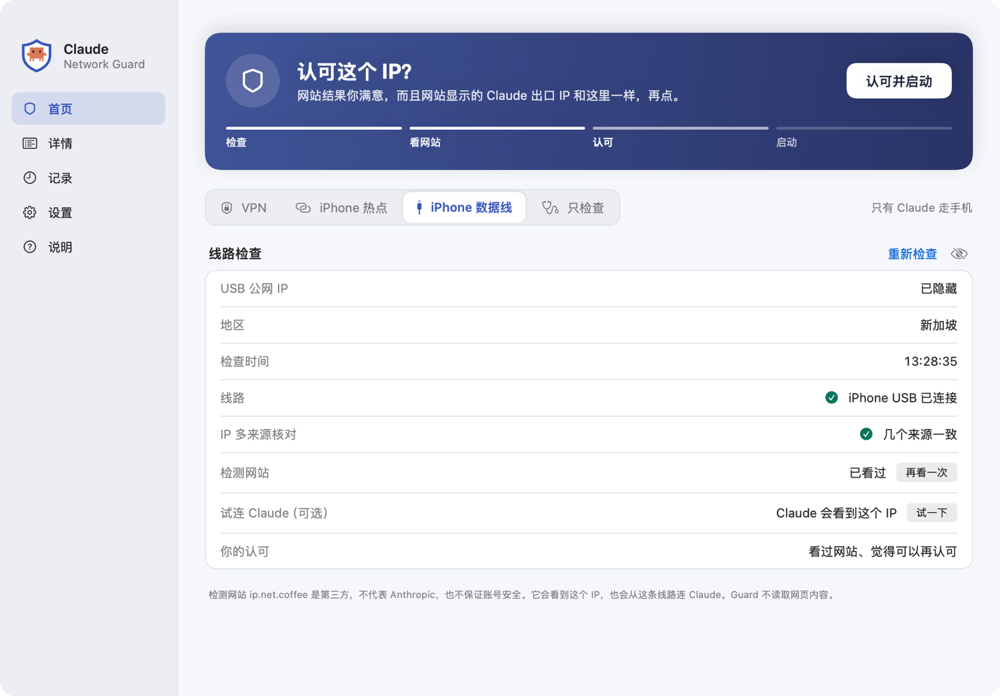

<div align="center">


# Claude Network Guard

**出门在外，让 Claude 只走你认可的那条网络。**

手机漫游、数据线、热点、VPN，你选一条、亲眼看过 IP、点认可。
线路一断或 IP 一变，Claude 立刻断网，绝不偷偷换到别的网络。

    

**简体中文** · [English](README.en.md)

[为什么做它](#为什么做它) · [三种用法](#三种用法) · [快速开始](#快速开始) · [⚠️ 重点边界](#️-使用前必须知道的边界) · [常见问题](#常见问题)

<picture>
  <source media="(prefers-color-scheme: dark)" srcset="docs/images/running-dark.png">
  
</picture>

<sub>截图均为示例数据</sub>

</div>

> [!IMPORTANT]
> **个人开源项目，非官方，与 Anthropic 无关。** 它只管“Claude 走哪条网络”，**不保证账号安全，不对封号、流量费或任何损失负责。** 用之前请先读[边界](#️-使用前必须知道的边界)。

---

## 为什么做它

在新加坡读书、工作的朋友（比如 NTU、NUS 的同学）出门旅行、出差时，常见的做法是：**开着本地手机号的国际漫游，让电脑用手机的流量上网**，而不是去连机场、酒店来路不明的 Wi‑Fi。

问题在于，Mac 不会老老实实只用你想用的那条网络：

- 数据线一松、热点一断，Mac **自动换回** 酒店 Wi‑Fi，Claude 跟着换，你根本不知道；
- VPN、代理软件一重启或崩溃，流量会**直接走本地网络**出去；
- 你想让 Claude 走漫游，又不想让整台电脑的更新、网盘、视频把漫游流量吃光。

**Claude Network Guard 就是来管这件事的：** 只把 Claude 锁在你认可的那条网络上，其他软件照常。

## 设计理念

1. **只管 Claude，不动别的。** 只有从 Guard 打开的 Claude Desktop（含 Code、内置浏览器、终端和它运行的命令）被锁住，浏览器、微信这些照常上网。
2. **IP 由你来判断。** Guard 不给 IP 打分，而是带你去检测网站亲眼看一下，你点了「认可」才放行。
3. **出了问题就断网，绝不将就。** 规则写在 macOS 自带的防火墙（内核）里：线路断了、IP 变了、规则被别的软件清掉，Claude 都是断网，而不是换条路继续连。Guard 界面崩了也照样生效。

## 三种用法

| | ① 漫游 + 数据线（推荐） | ② 漫游 + 热点 | ③ 整机 VPN |
|---|---|---|---|
| 怎么连 | iPhone 开漫游和个人热点，用数据线插到 Mac | iPhone 开漫游和个人热点，Mac 连它的 Wi‑Fi | Mac 上开全局 VPN（TUN 模式） |
| 谁走这条线 | **只有 Claude** | 整台 Mac | 整台 Mac |
| 其他软件 | 照常走本地 Wi‑Fi 或 VPN，**不吃漫游流量** | 也走漫游 | 也走 VPN |
| Claude 的 IP | 手机漫游的出口 | 手机漫游的出口 | VPN 节点 |
| Guard 做什么 | 锁住 Claude + 每 5 秒核对 IP | 锁住线路 + 核对 IP | 锁住线路 + 核对 IP，拦截绕过 VPN 去连 Claude 的软件 |
| 断了会怎样 | Claude 立刻断网，不退出，等你恢复 | 同左 | 同左 |

> 选 ③ 就不是漫游了，适合在家、在学校用自己的 VPN。

**关于漫游的出口：** 一般来说，本地手机号漫游时流量会绕回本国运营商再出去，所以 IP 通常显示在你办卡的国家。但**有些旅行 eSIM、套餐是在当地直接出去的**，IP 会是当地的。Guard 会带你去检测网站看，**看清楚再认可**。

## 支持什么设备

| | 支持 | 说明 |
|---|---|---|
| 电脑 | **只支持 Mac**：苹果芯片（M1 及以后） | **在 macOS 27 上实测过。** 其他版本理论上支持（代码最低按 macOS 13 编写），但没有测过，装不上或有问题欢迎提 Issue。Intel Mac、Windows、Linux 都不支持 |
| 手机 | **iPhone**：能开个人热点就行 | 安卓**没有适配**，识别不了 |
| Claude | 「应用程序」里的官方 Claude Desktop | 只认 Anthropic 签名的那个 |

不需要 Xcode，不需要苹果开发者账号，不需要服务器。

---

## 快速开始

### 方式一：交给你的 AI 助手

把下面这段话发给你常用的 AI 编程助手（Codex、Cursor 等都行），让它帮你装，**输密码那一步你自己来**：

```text
帮我在这台 Mac 上安装 https://github.com/z3Ra1n/claude-network-guard ：
先确认 Claude Desktop 已经完全退出，然后 git clone 到 ~/ClaudeNetworkGuard，
运行 ./install.sh。遇到要输管理员密码时停下来让我自己输。装完告诉我结果。
```

### 方式二：自己装（4 步）

**1. 完全退出 Claude**：在 Claude 里按 ⌘Q。只关窗口不算。

**2. 打开「终端」**（按 ⌘ 空格，搜“终端”），粘贴这一行，按回车：

```bash
git clone https://github.com/z3Ra1n/claude-network-guard.git ~/ClaudeNetworkGuard
```

> 如果弹出“安装命令行开发者工具”，点「安装」，装好后再粘贴一次。

**3. 再粘贴这一行，按回车：**

```bash
cd ~/ClaudeNetworkGuard && ./install.sh
```

> 会在你的 Mac 上现场编译，要等几分钟。让你输密码时输 Mac 的开机密码，**屏幕上不显示是正常的**，输完按回车。

**4. 装好后 Guard 会自动打开。** 以后在「应用程序」里找 **Claude Network Guard**。

**装完还要允许两件事：**

| 弹出什么 / 去哪里 | 怎么点 |
|---|---|
| 提示“已添加后台项目”（或「系统设置 › 通用 › 登录项与扩展」） | 让 Guard 保持**打开**，断网和拦截都靠它 |
| Guard 里「设置 › 异常通知」 | 点启用，再点「允许」，断网时会提醒你 |

iPhone 上：插线后点「**信任**此电脑」；「设置 › 个人热点」打开「**允许其他人加入**」；出门前确认**漫游已打开**。

> Guard **不需要**完全磁盘访问、辅助功能、屏幕录制、定位等权限。有东西以它的名义要这些，不要给。

### 每次怎么用

**一直点首页卡片上的按钮就行。**

1. **选线路，点「检查线路」。** 这一步不连 Claude。
2. **点「打开检测网站」，** 看这个 IP 在哪、是什么类型、干不干净，看完点「看完了」。
3. **满意就点「认可并启动」。** 再核对一次 IP，对得上才打开 Claude。
4. **用完点「停止并退出 Claude」。**

| 卡片颜色 | 意思 |
|---|---|
| 🔵 蓝 | 没在保护 |
| 🟢 绿 | 保护中，正常 |
| 🟡 黄 | 保护中，有件事要你看一眼 |
| 🔴 红 | 已断网，等你处理 |

| 认可这个 IP | 线断了 |
|:---:|:---:|
|  |  |

---

## ⚠️ 使用前必须知道的边界

### 1. 它不改变“Claude 能不能用”

Claude 能在哪里用、怎么用，由 **Anthropic 的支持地区和服务条款**决定。Guard 只管“Claude 的流量走哪条网络”，**不会让任何使用方式变得合规，也不保证 Anthropic 怎么看待某个 IP 或账号**。请自己确认并遵守 Anthropic 的条款和所在地的法律。

### 2. 它只管一个东西

| | |
|---|---|
| ✅ 管 | **从 Guard 打开的** Claude Desktop：聊天、Code、内置浏览器、终端面板，以及它们运行的命令 |
| ❌ 不管 | **手机上的 Claude App**、浏览器里的 claude.ai、浏览器的 Claude 插件，它们走自己当时的网络 |
| ❌ 不管 | 从程序坞、Spotlight 直接打开的 Claude（保护中会被 Guard 关掉） |
| ❌ 不管 | 你自己在终端、VS Code 里运行的 `claude` |
| ❌ 不管 | Claude 帮你打开的其他软件（Safari、Xcode、模拟器等），它们用自己的网络 |

**想全程只用认可过的 IP，保护期间就别用手机和网页登录 Claude。** 另外建议关掉 Claude 的“开机自动打开”，免得它在你启动保护前就自己联网。

### 3. 防不住的

- **网络没断、IP 悄悄变了的几秒到十几秒。** Guard 每 5 秒核对一次，发现了才断网。
- **写在内容里的 IP。** 截图、网页、文件里写着你的 IP，Claude 读到就知道了。所以 Guard 默认隐藏 IP；也别让 Claude 打开查 IP 的网页或账号登录记录。
- **苹果系统自己的联网**，比如推送、证书检查。
- **没设成系统代理的本机代理端口。** 命令写死了那个端口，会从代理出去。

### 4. 还没实测过的

- **真实的跨境漫游**（iPhone 数据线、热点、VPN 三种模式都实测过，但没有带着漫游出境测过）
- 睡眠唤醒、重启电脑、连续用几个小时
- 公网 IP 真的变化时的断网（只用模拟测过）
- 另一台 Mac、别的 macOS 版本、其他 VPN 和代理软件、有原生 IPv6 的网络

已经实测过的内容见 [VERIFICATION.md](VERIFICATION.md)，每一条细节边界见 [BOUNDARIES.md](BOUNDARIES.md)。

### 5. 免责

本项目按“原样”提供，作者不对账号被限制或封禁、流量费用、数据丢失或其他任何后果负责。代码全部公开，欢迎自己审查。

---

## 常见问题

**电脑开着 VPN 浏览网页，手机插线保护 Claude，会互相影响吗？**
不会（实测过）。浏览器照常走 VPN，Claude 只走手机。

**VPN 或代理软件重启、崩溃、切到“直连”，会把本地 IP 漏给 Claude 吗？**
按规则和实测，不会：VPN 一断 Claude 不到 1 秒就断网；代理改成直连、或别的软件想绕过 VPN 去连 Claude，都会被拦下，首页会提示“拦下了 xxx”。唯一的空隙是网络没断但出口悄悄换了（比如代理自动换节点），所以**用 VPN 时请把 Claude 固定在一个节点**，别用自动选择、故障转移、负载均衡这类节点组。

**漫游流量会不会被电脑的其他软件吃光？**
用 ① 数据线模式不会：只有 Claude 走手机，其他软件照常走 Wi‑Fi。用 ② 热点模式，整台 Mac 都走手机。

**Claude 的云端项目受保护吗？**
云端跑的部分在 Anthropic 的服务器上，用的是服务器的 IP。你在 Guard 打开的 Claude 里查看、操作它们是受保护的；用手机 App 或网页看就不受保护。

**变红了？**
Claude 没关，聊天都在。接好网络，点「检查并恢复」。它不会自己恢复，要你确认。

**IP 变了？**
变回原来的 IP 可以直接恢复；新 IP 要重新检查、看网站、认可。

**要重新登录 Claude？**
登录会跳到外部浏览器，保护中会被拦。先停止保护；用数据线的话登录时关掉 Wi‑Fi，让整台 Mac 走手机；登录好再打开 Wi‑Fi，从 Guard 重新启动。

**提示“拦下了某个软件”？**
有个保护外的软件想从别的网络连 Claude，已被拦住。多半是浏览器的 Claude 插件或 claude.ai 网页，关掉就好。

**没识别到 iPhone？**
解锁手机，点「信任」，打开个人热点；还不行就重插线。

**提示“两条线路出口相同”？**
你的 Mac 连的 Wi‑Fi 就是这台手机的热点。换一个 Wi‑Fi，或者改选「iPhone 热点」。

**要连学校、公司的服务器？**
保护中默认不让 Claude 连内网。在「设置 › 允许的内网地址」里填 `IP:端口`，只放行这一个。

**Guard 闪退了？**
不影响保护，断网和拦截由后台组件和系统防火墙执行。

<details>
<summary>启动前最好关掉的东西（Guard 大多会自己提醒）</summary>

| 关什么 | 为什么 |
|---|---|
| Claude Desktop（⌘Q） | 要从 Guard 打开才受保护 |
| 浏览器里的 claude.ai 和 Claude 插件 | 不关会被拦，并一直提醒 |
| 代理软件里的“系统代理”开关 | Guard 没法确认这类流量走哪条网络。**整机 VPN（TUN 模式）不用关** |
| 带“DNS 代理”的公司、学校安全软件 | 可能接管域名查询。在「系统设置 › 网络 › 过滤条件与代理」里看 |

</details>

<details>
<summary>保护中用不了的</summary>

- 在外部浏览器里登录 Claude（先停止保护）
- Claude 里的 `sudo`
- 局域网、学校和公司内网（可在设置里单独放行）
- UDP、QUIC、IPv6（会自动退回普通方式，一般感觉不到）

</details>

<details>
<summary>Guard 会联系哪些网站</summary>

没有统计，没有自己的服务器。检查 IP 时会访问这些公开服务，它们会看到所选网络的 IP：

- Cloudflare、AWS `checkip`、ipify、icanhazip：读公网 IP
- `ip.net.coffee`：第三方检测网站，你点了才打开
- `claude.ai`、`api.anthropic.com`：你点「试连 Claude」才连

</details>

---

## 更新和卸载

先停止保护，退出 Guard 和 Claude，再在「终端」里粘贴：

```bash
cd ~/ClaudeNetworkGuard && git pull && ./install.sh
```

```bash
cd ~/ClaudeNetworkGuard && ./uninstall.sh
```

## 文档

| 想知道 | 看这里 |
|---|---|
| 每一条边界 | [BOUNDARIES.md](BOUNDARIES.md) |
| 实现原理 | [ARCHITECTURE_USB.md](ARCHITECTURE_USB.md) |
| 各版本测了什么 | [VERIFICATION.md](VERIFICATION.md) |
| 自己动手验证 | [ACCEPTANCE.md](ACCEPTANCE.md) |

## 开源与许可

**[MIT 许可](LICENSE)**：代码全部公开，任何人都可以免费使用、修改、再分发。

发现问题欢迎提 [Issue](https://github.com/z3Ra1n/claude-network-guard/issues)，想改进欢迎直接提 PR。

**觉得有用的话，点个 ⭐ Star 就是最大的支持。**

<sub>Claude 是 Anthropic 的商标。本项目是独立的社区项目，与 Anthropic 没有任何隶属或合作关系。</sub>
