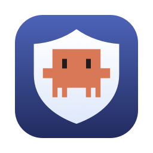
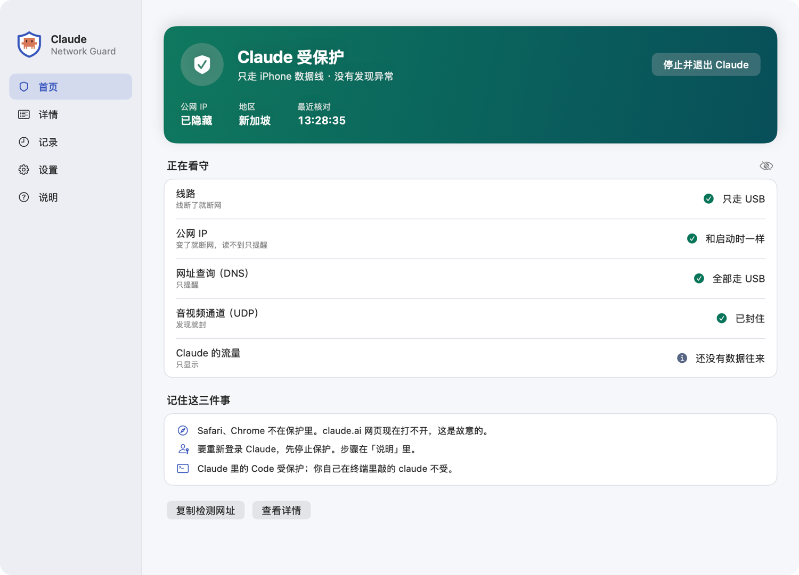
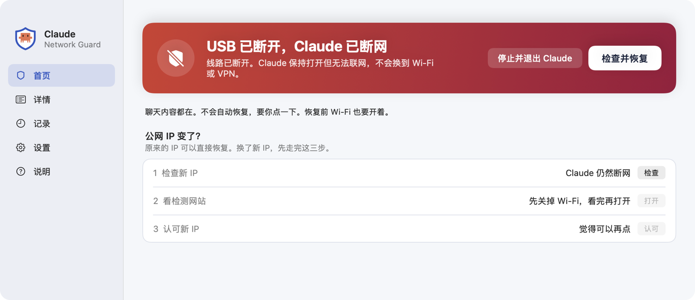
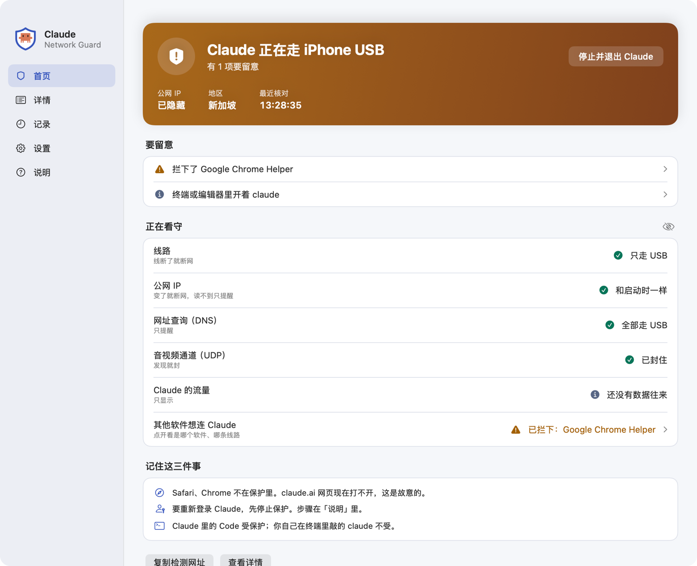
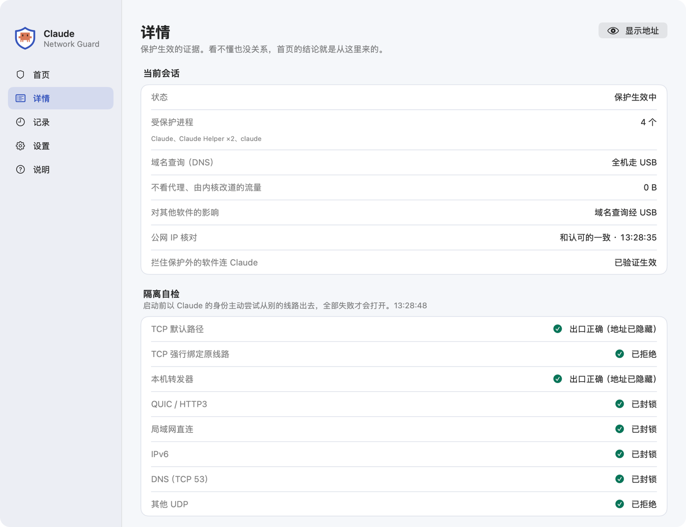

<div align="center">



# Claude Network Guard

**让 Claude Desktop 只走你亲自认可过的那条网络。**
线断了、IP 变了，Claude 立刻断网，不会偷偷换到别的线路。

   

**简体中文** · [English](README.en.md)

[安装](#安装一次) · [要打开的权限](#要打开的权限) · [每次怎么用](#每次怎么用) · [边界](#使用前要知道的边界) · [常见情况](#遇到事情怎么办)

<picture>
  <source media="(prefers-color-scheme: dark)" srcset="docs/images/running-dark.png">
  
</picture>

<sub>截图均为示例数据</sub>

</div>

> 非官方软件，与 Anthropic 无关。Claude 的名字和形象属于 Anthropic。

---

## 它解决什么问题

Mac 同时连着 Wi‑Fi、VPN、手机时，线路一断，系统会自动换到另一条。Claude 也跟着换，而且你不知道。

Guard 把 Claude Desktop 锁在一条线路上：**只有你看过、认可过的 IP 才放行，别的一律不通。** 其他软件照常上网。

平时不启动保护，它什么都不做。

## 目前的能力

| 你选的线路 | 谁走这条线 | 线断了或 IP 变了 |
|---|---|---|
| **iPhone 数据线** | 只有 Claude，其他软件照常走 Wi‑Fi 或 VPN | Claude 断网，不退出 |
| **整机 VPN** | 整台 Mac | Claude 断网，不退出 |
| **iPhone 热点** | 整台 Mac | Claude 断网，不退出 |
| **只检查** | 不保护，只看现在的网络 | — |

- **先检查，再认可，再启动。** 没认可过的 IP 不会启动 Claude。
- **内核级断网。** 规则在 macOS 自带的防火墙里，Guard 界面崩了也照样生效。
- **子进程一起管。** Claude 里的 Code、终端面板、命令、MCP、内置浏览器都在保护内。
- **持续核对公网 IP。** 5 秒一次，变了就断网。
- **拦保护外的软件连 Claude。** 比如浏览器里的 Claude 插件，会告诉你拦下了谁。
- **封住容易漏的通道。** UDP、QUIC、IPv6、局域网、TCP 53 端口的域名查询。
- **每次启动前自检。** 主动尝试从别的线路出去，全部失败才打开 Claude。
- **用完还原。** 停止后不留规则、代理和域名配置。

| 认可这个 IP | 线断了 |
|:---:|:---:|
|  |  |
| **有事要留意** | **自检明细** |
|  |  |

它**不提供**网络、代理或账号，不改指纹、时区和语言，也不给 IP 打分。

---

## 需要什么

- 苹果芯片的 Mac（M1 及以后），macOS 13 或更新。**目前只在 macOS 27 上实测过**
- 「应用程序」里装好官方的 Claude Desktop
- 三选一：iPhone + 数据线、整机 VPN、iPhone 热点
- Mac 的管理员密码

不需要 Xcode，也不需要苹果开发者账号。

## 安装（一次）

**1. 退出 Claude Desktop**（⌘Q，关窗口不算）。

**2. 打开系统自带的「终端」，粘贴：**

```bash
git clone https://github.com/james123wang5/claude-network-guard.git ~/ClaudeNetworkGuard
```

> 第一次会弹出“安装命令行开发者工具”。点「安装」，装完再粘贴一次。

**3. 再粘贴：**

```bash
cd ~/ClaudeNetworkGuard && ./install.sh
```

> 会在你的 Mac 上编译，要等一会儿。提示输密码时输 Mac 登录密码，**屏幕上不显示是正常的**。

**4.** Guard 会自动打开。以后从「应用程序」里打开 **Claude Network Guard**。

请用上面的方法装。网页上下载的 zip 可能被 macOS 拦住。

**更新：** 停止保护，退出 Guard 和 Claude，然后运行：

```bash
cd ~/ClaudeNetworkGuard && git pull && ./install.sh
```

## 要打开的权限

| 什么 | 在哪里 | 为什么 | 必须吗 |
|---|---|---|---|
| 命令行开发者工具 | 安装时弹窗，点「安装」 | 在你自己的 Mac 上编译 | ✅ |
| 管理员密码 | 安装和更新组件时输 | 装后台组件。防火墙规则要管理员权限 | ✅ |
| 允许后台运行 | 「系统设置 › 通用 › 登录项与扩展」。如果提示“已添加后台项目”，保持打开 | 断网和拦截靠它 | ✅ |
| 通知 | Guard「设置 › 异常通知 › 启用」，再点「允许」 | 断网时提醒你 | 建议 |
| 信任此电脑 | iPhone 插线后弹窗，点「信任」 | 用数据线上网 | 用数据线时 ✅ |
| 个人热点 | iPhone「设置 › 个人热点」，打开「允许其他人加入」 | 用数据线或热点上网 | 用手机时 ✅ |

**不需要**：完全磁盘访问、辅助功能、屏幕录制、通讯录、定位、系统扩展。Guard 不要求这些。

## 启动前先关掉

| 关什么 | 为什么 |
|---|---|
| Claude Desktop（⌘Q） | 要从 Guard 打开才受保护 |
| 浏览器里的 claude.ai 和 Claude 插件 | 不关会被拦，并一直提醒 |
| 终端、编辑器里的 `claude` | 不受保护 |
| 代理软件的“系统代理”开关 | 没法确认流量走哪条线。**整机 VPN 不用关** |
| 带“DNS 代理”的公司、学校安全软件 | 可能接管域名查询。在「系统设置 › 网络 › 过滤条件与代理」里看 |

大部分 Guard 会自己发现，在首页提醒你：

<div align="center"></div>

## 每次怎么用

一直点首页那张卡片上的按钮就行。

1. **选线路，点「检查线路」。** 这一步不连 Claude。
2. **点「打开检测网站」，** 看这个 IP 的情况，看完点「看完了」。用数据线时会开一个空白浏览器窗口从手机出去，不用关 Wi‑Fi。
3. **满意就点「认可并启动」。** 会再核对一次 IP，对得上才打开 Claude。
4. **用完点「停止并退出 Claude」。** 之后从程序坞打开就是普通状态。

认可 24 小时内有效，IP 一变就不算数。

| 卡片颜色 | 意思 |
|---|---|
| 🔵 蓝 | 没启动 |
| 🟢 绿 | 保护中 |
| 🟡 黄 | 保护中，有事要留意 |
| 🔴 红 | 已断网，等你处理 |

---

## 使用前要知道的边界

### 管什么，不管什么

| | |
|---|---|
| ✅ | 从 Guard 启动的 Claude Desktop：聊天、Code、内置浏览器、终端面板，以及它们运行的命令 |
| ❌ | claude.ai 网页版、手机上的 Claude |
| ❌ | 浏览器里的 Claude 插件（Claude in Chrome） |
| ❌ | 从程序坞直接打开的 Claude |
| ❌ | 你自己在终端、VS Code 里运行的 `claude`（[有一个例外](BOUNDARIES.md#终端里的-claude)） |
| ❌ | Claude 帮你打开或操作的软件，例如 Safari、Xcode、模拟器：它们用自己的网络 |

### 防不住的

- **对方悄悄换 IP 的那几秒到十几秒。** 线没断、只是 IP 变了，要核对到才会断网。
- **写在内容里的 IP。** 截图、网页、文件里写着你的 IP，Claude 读到就知道了。
- **苹果系统自己的请求**，例如推送、检查证书。
- **在 Anthropic 服务器上执行的操作**，例如联网搜索，本来就不经过你的 Mac。
- **没设成系统代理的本机代理端口。** 命令写死了那个端口，就会从代理出去。
- **账号安全。** 它不能让账号“更安全”，也不保证 Anthropic 怎么看待某个 IP。请遵守 Anthropic 的服务条款和所在地的规定。

### 保护中用不了的

- 在外部浏览器里登录 Claude（先停止保护再登录）
- Claude 里的 `sudo`
- 局域网和公司、学校内网（可在设置里单独放行）
- UDP、QUIC、IPv6（会自动退回普通方式，一般没感觉）

### 还没实测的

睡眠唤醒和重启、公网 IP 真的变化、另一台 Mac 和其他 macOS 版本、其他 VPN、原生 IPv6 网络、本机虚拟机里的 Cowork。

完整的边界和实测情况：**[BOUNDARIES.md](BOUNDARIES.md)**

## 它会联系谁

没有统计，没有自己的服务器。检查和核对 IP 时会访问这些公开服务，它们会看到所选线路的 IP，部分检查也会看到 Mac 默认线路的 IP：

- Cloudflare、AWS `checkip`、ipify、icanhazip：读公网 IP
- `ip.net.coffee`：第三方检测网站，你点了才打开
- `claude.ai`、`api.anthropic.com`：你点「试连 Claude」才连

---

## 遇到事情怎么办

| 情况 | 怎么办 |
|---|---|
| **变红，已断网** | Claude 没关，聊天都在。接好线路，点「检查并恢复」。不会自动恢复 |
| **IP 变了** | 回到原来的 IP 可以直接恢复。新 IP 要重新检查、看网站、认可 |
| **要重新登录 Claude** | 先停止保护再登录。用数据线的，登录时关掉 Wi‑Fi，登录完再打开 |
| **提示拦下了某个软件** | 多半是浏览器的 Claude 插件或 claude.ai 网页。移除插件、关掉网页 |
| **Claude 自动更新后被关掉** | 它会在保护外重开自己，Guard 会关掉。从 Guard 再启动一次 |
| **没有识别到 iPhone USB** | 解锁手机、点信任、打开个人热点，必要时重插 |
| **提示两条线路出口相同** | Mac 的 Wi‑Fi 连的就是这台手机。换一个 Wi‑Fi |
| **要连公司、学校的服务器** | 在「设置 › 允许的内网地址」填 `IP:端口` |
| **Guard 闪退** | 不影响保护，断网和拦截由后台组件和系统内核执行 |

## 卸载

停止保护，退出 Guard 和 Claude，然后运行：

```bash
cd ~/ClaudeNetworkGuard && ./uninstall.sh
```

## 文档

| 想知道 | 看这里 |
|---|---|
| 每一条边界和实测情况 | [BOUNDARIES.md](BOUNDARIES.md) |
| 怎么实现的 | [ARCHITECTURE_USB.md](ARCHITECTURE_USB.md) |
| 各版本测了什么 | [VERIFICATION.md](VERIFICATION.md) |
| 自己动手验证 | [ACCEPTANCE.md](ACCEPTANCE.md) |
